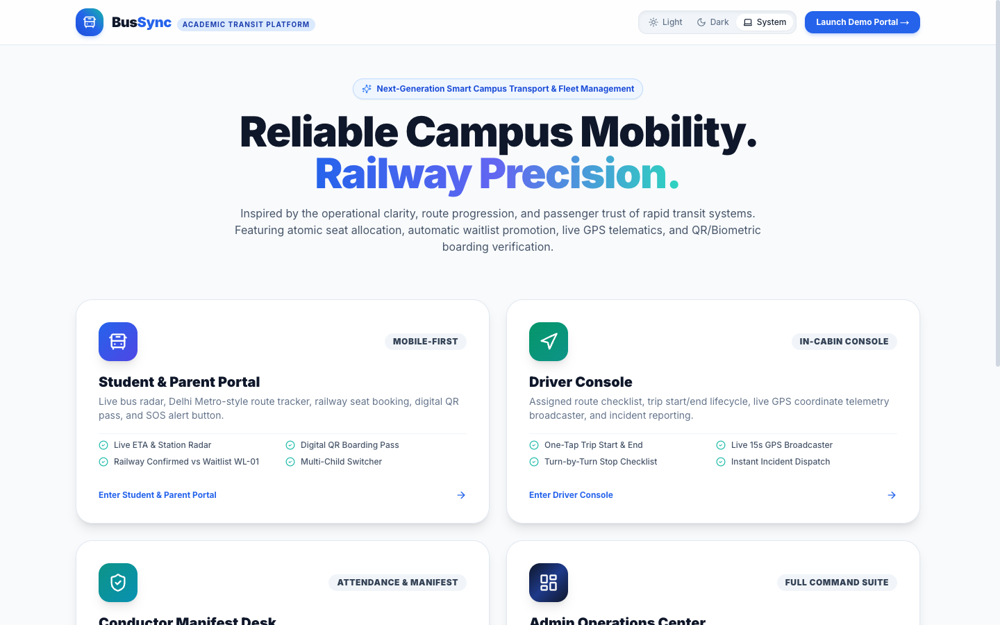
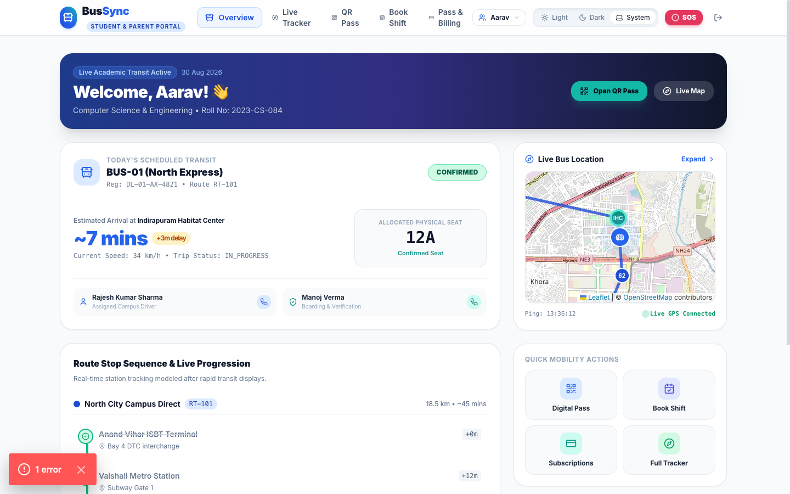
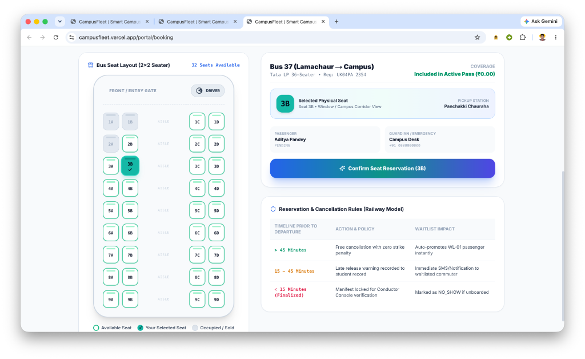
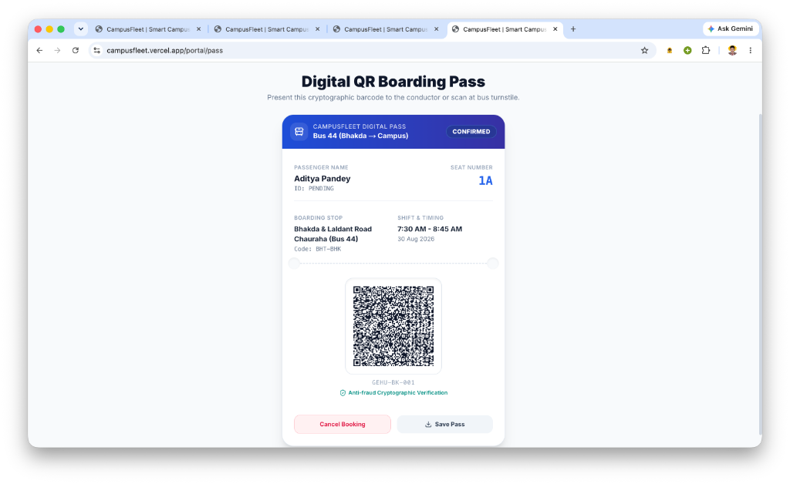
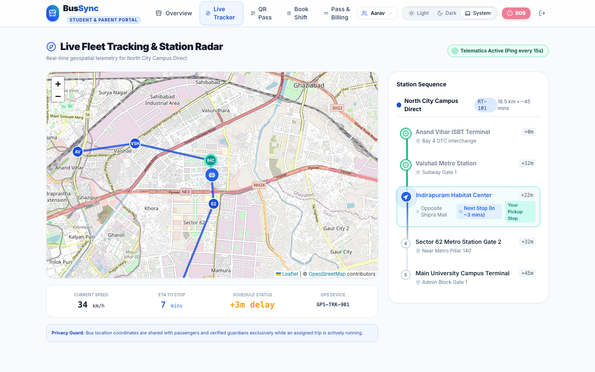
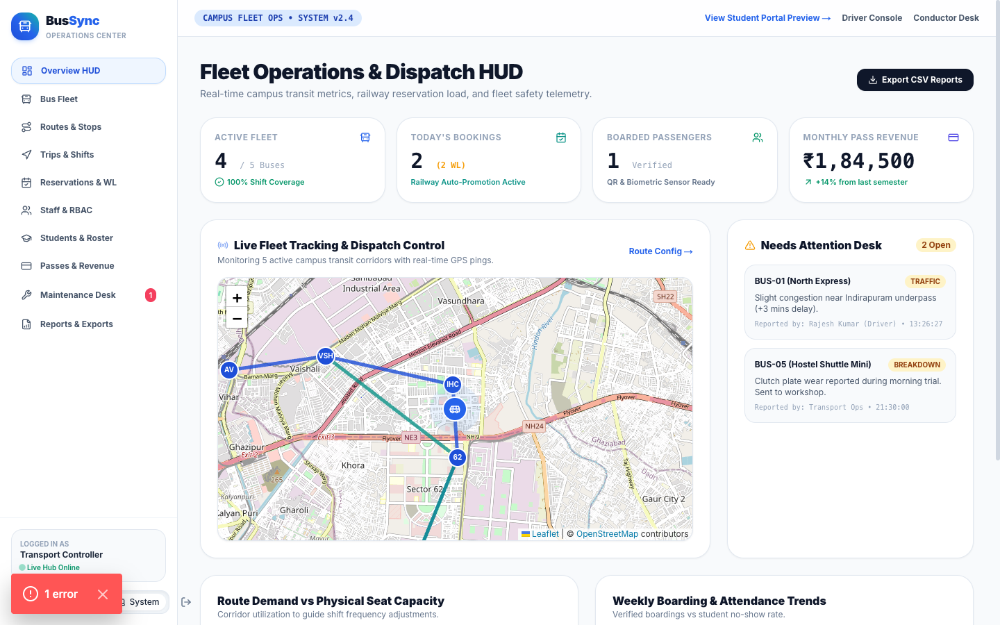
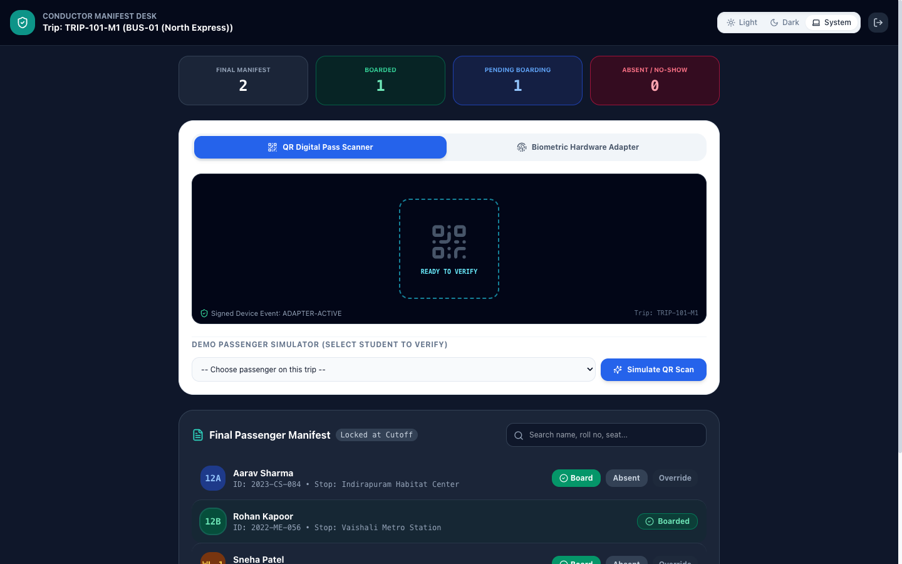
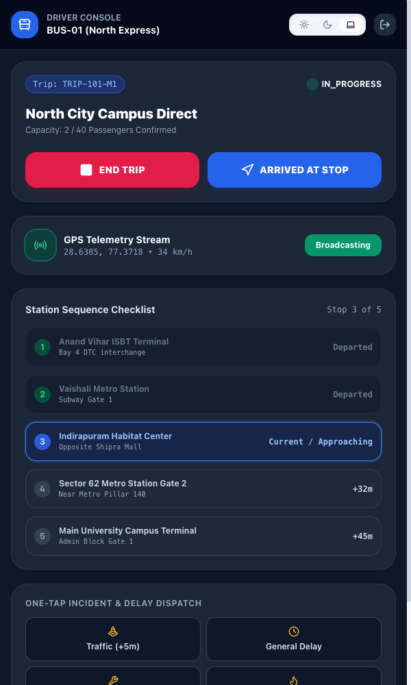

# 🚌 CampusFleet — Autonomous Campus Transit Intelligence & Fleet Telematics Platform

> **Production-Quality Full-Stack Academic Project**  
> Built with **Next.js 14 (App Router), TypeScript, Tailwind CSS, Supabase PostgreSQL, Razorpay, Upstash Redis, Leaflet, and ESP32 IoT Telematics**.  
> Inspired by the seat allocation UX of **RedBus & AbhiBus**, the live radar experience of **Delhi Metro**, and the operational rigor of production fleet management.

[](https://campusfleet.vercel.app)
[](https://github.com/AdityaPandey-DEV/CampusFleet)

🌐 **Official Production URL**: [**https://campusfleet.vercel.app**](https://campusfleet.vercel.app)

* 🚀 **Main Live Web App**: [https://campusfleet.vercel.app](https://campusfleet.vercel.app)
* ⚡ **High-Availability Mirrors**: [https://ridx.vercel.app](https://ridx.vercel.app) • [https://campusfleet-live.vercel.app](https://campusfleet-live.vercel.app)

---

## 📸 Application Interface & Visual Tour

### 1. Unified Gateway & Role Portal Launchers


### 2. Student & Parent Live Transit Radar (`/portal`)


### 3. RedBus/AbhiBus-Inspired 2×2 Seat Selection & Auto-Allocation (`/portal`)


### 4. Anti-Fraud Cryptographic Digital Boarding Pass (`/portal/qr`)


### 5. Full-Screen Live GPS Radar & Metro Station Progression (`/portal`)


### 6. Admin Operations Control HUD & Analytics (`/admin`)


### 7. Conductor Manifest Desk & QR/RFID Attendance Scanner (`/conductor`)


### 8. Driver In-Cabin Console (`/driver`)
<p align="center">
  
</p>

---

## 🌟 Key Highlights & Innovations

1. **RedBus & AbhiBus-Inspired Seat Allocation Engine**
   - **AI Auto-Assignment**: The dispatch engine (`/api/dispatch`) intelligently assigns each student to the optimal bus + stop + seat based on proximity scoring, route demand, and capacity.
   - **Physical 2×2 Chassis Seat Map**: Visual bus seat layout (like RedBus/AbhiBus) with `2x2`, `2x3`, `3x2`, and continuous rear bench configurations — not a generic list.
   - **Atomic Distributed Seat Locking**: Redis `SETNX` + PostgreSQL `seat_attendance_transaction()` PL/pgSQL function prevents double-booking under concurrent requests (race-condition safe).
   - **Bus Switch Requests**: Students can request to switch between buses, processed through the `bus_switch_requests` table with approval workflows.
   - **Semester Pass-Driven Checkout**: Unlike RedBus per-ticket payments, CampusFleet uses semester transit subscriptions — selecting a seat is a **digital boarding declaration** linked to conductor attendance rosters.

2. **7 Role-Based Portals**
   - **Student & Parent Portal (`/portal`)**: Live bus radar, Metro-style station progression, ETA countdown, anti-fraud rotating QR boarding pass, Razorpay fee payments, multi-language support (10 Indian languages), Emergency SOS.
   - **Driver Console (`/driver`)**: Mobile-first cabin console — 1-tap Trip Start/End, real-time 15s GPS telematics broadcasting, stop checklist, incident dispatcher (Traffic, Breakdown, Fuel, Delay, Emergency).
   - **Conductor Console (`/conductor`)**: Frozen passenger manifest with locked KYC photos, 60 FPS `jsQR` camera scanner with <150m Haversine geofence anti-spoof validation, RFID tap-in support, manual override with auditable justification.
   - **Admin (`/admin`)**: Campus management, user administration, maintenance oversight, system settings.
   - **Transport Admin (`/transport-admin`)**: Route corridor builder with interactive Leaflet map, stop/bus/trip management, fee zone configuration, RFID card mapping, ESP32 device management, seat QR generation, billing, reports, CSV exports.
   - **Transport Manager (`/transport-manager`)**: Today's trip operations overview, crew assignment, demand analysis heatmaps, bus merge optimization decisions, operational flowcharts.
   - **Teacher (`/teacher`)**: Class-wise student transport arrivals, bus-based attendance patterns, commute tracking, gate pass management, schedule view.

3. **IoT Hardware Integration (ESP32 + RFID)**
   - **ESP32 GPS Telematics Devices**: Real hardware GPS broadcasters mounted on buses, ingesting live location data via `/api/telematics/devices`.
   - **RFID Card Attendance**: Students tap RFID cards on bus-mounted readers. The `/api/telematics/rfid` endpoint processes tap events, verifies card-to-student mapping, and records `seat_attendance` in real-time.
   - **Device Management Panel**: Transport admins configure ESP32 devices and map RFID cards to students via dedicated admin pages.

4. **Razorpay Payment Gateway**
   - Integrated Razorpay for semester transport fee collection via `/api/payments/razorpay`.
   - Supports subscription plan selection, online checkout, webhook-driven payment confirmation, and automatic subscription activation via the `fulfill_subscription_on_payment()` database trigger.
   - Payment submissions tracked with full approval workflow (`payment_submissions` table).

5. **6 Graph Algorithms for Route Optimization** (implemented from scratch — no library imports)
   - **Dijkstra's Shortest Path** — Finds optimal bus route between any two stops (O((V+E) log V))
   - **Bellman-Ford Nearest Stops** — Discovers best nearby stops with connectivity bonuses (handles negative weights)
   - **A\* Search** — Faster point-to-point pathfinding using Haversine heuristic
   - **Floyd-Warshall All-Pairs** — Precomputes shortest distances for dashboard analytics (O(V³), O(1) lookup)
   - **Kruskal's MST** — Minimum infrastructure to connect all stops (Union-Find with path compression)
   - **Direct Express Engine** — Skips empty stops when all passengers are aboard, saving 10-15 mins/trip

6. **Anti-Fraud QR Attendance with Location Verification**
   - Dynamic QR boarding passes rotate every 30 seconds with HMAC cryptographic nonces — defeating static screenshot sharing.
   - GPS geofence validation ensures conductor and student are physically within the designated stop radius (<150m Haversine).
   - Biometric Hardware Adapter architecture complete and ready for physical scanner deployment.

7. **Complete Light / Dark Theme Engine**
   - System preference detection via `prefers-color-scheme`.
   - Light, Dark, and System mode selector with local persistence.
   - Accessible WCAG contrast ratios across all cards, maps, charts, and digital passes.

---

## 🚀 Technology Stack

### Frontend
| Technology | Purpose |
|-----------|---------|
| **Next.js 14 (App Router)** | React-based full-stack framework with SSR |
| **React 18** | Component-based UI rendering |
| **TypeScript** | Type-safe JavaScript with compile-time checks |
| **Tailwind CSS** | Utility-first responsive styling |
| **Framer Motion** | Smooth animations and micro-interactions |
| **Leaflet + React-Leaflet** | Interactive maps with custom bus markers |
| **Recharts** | Data visualization (route demand, attendance trends) |
| **Lucide React** | Modern SVG icon library |
| **qrcode.react / jsQR** | QR generation and 60 FPS camera-based scanning |

### Backend
| Technology | Purpose |
|-----------|---------|
| **Supabase PostgreSQL** | Cloud-hosted relational database with RLS |
| **Supabase Realtime** | WebSocket-based live bus location broadcasting |
| **Next.js API Routes** | 29 API route groups (81 REST endpoints) |
| **Razorpay** | Online payment gateway for fee collection |
| **jose (JWT)** | Custom HS256 token signing/verification |
| **bcryptjs** | Password hashing |
| **Nodemailer** | Email-based OTP delivery |
| **Upstash Redis** | Rate limiting, seat locking, and session caching |
| **Zod** | Runtime schema validation for API inputs |
| **MongoDB** | Auxiliary NoSQL data store |
| **Vercel Blob** | Cloud file storage (receipts, photos) |

### IoT & Hardware
| Technology | Purpose |
|-----------|---------|
| **ESP32** | GPS telematics device mounted on buses |
| **RFID Readers** | Contactless student attendance via card tap |

### Infrastructure
| Service | Role |
|---------|------|
| **Vercel** | Serverless deployment (edge functions, CDN, CRON) |
| **Supabase** | Managed PostgreSQL + Realtime + Storage |
| **Upstash** | Serverless Redis |
| **Razorpay** | Payment processing |

### Testing
| Technology | Purpose |
|-----------|---------|
| **Vitest** | 15 test suites covering reservation engine, attendance, bookings, telematics, payments, drivers, rollover, and more |

---

## 🗄️ Live Database Schema (44 Base Tables + 9 Views)

The production PostgreSQL database (queried live from Supabase) contains **44 base tables**, **9 materialized views**, and **10 PL/pgSQL atomic functions**, defined across **46 migration files**.

### Core Auth & Users
| Table | Purpose |
|-------|---------|
| `users` | User accounts with role, email, phone, avatar, campus linkage (13 columns) |
| `auth_otps` | Email OTP codes for passwordless login |
| `auth_rate_limits` | Brute-force protection rate limiting |

### Academic Hierarchy
| Table | Purpose |
|-------|---------|
| `academic_branches` | Department/branch definitions (e.g., CSE, ECE) |
| `academic_courses` | Degree programs (e.g., B.Tech, M.Tech) |
| `academic_sections` | Class sections (A, B, C) |
| `academic_specializations` | Specialization tracks within branches |
| `classes` | Academic class/section containers |
| `class_teachers` | Teacher ↔ class assignments |
| `class_shift_schedules` | Class-wise bus shift scheduling |

### Fleet & Infrastructure
| Table | Purpose |
|-------|---------|
| `buses` | Vehicle fleet registry (bus_number, registration, capacity, seat_layout, GPS device, total_rows) |
| `stops` | Bus stops with GPS coordinates, geofence radius, zone linkage |
| `routes` | Transit corridors with ordered stops, direction, distance, color coding |
| `route_stops` | Ordered stop sequence per route with arrival offsets |
| `shifts` | Daily shift definitions (MORNING/AFTERNOON/EVENING/CUSTOM) |
| `campuses` | University campus locations with geofence and fleet capacity |
| `transit_zones` | Fee zone corridors with semester pricing |

### People
| Table | Purpose |
|-------|---------|
| `staff` | Driver/conductor/admin staff records with employee codes |
| `students` | Student records with department, semester, primary stop, home GPS, zone, RFID card, class linkage (20 columns) |

### Operations (Core Dispatch & Attendance)
| Table | Purpose |
|-------|---------|
| `trips` | Daily scheduled trip instances (route + bus + shift + crew) |
| `bus_reservations` | AI-auto-assigned seat allocations with lock/unlock status, boarding tracking (19 columns) |
| `seat_attendance` | Individual seat-level attendance with verification method and timestamps (16 columns) |
| `attendance_records` | Aggregated check-in records with GPS verification and photo capture (17 columns) |
| `dispatch_configs` | Dynamic dispatch algorithm configuration |
| `dynamic_route_plans` | AI-generated route optimization plans |
| `plan_stops` | Stop sequence in dynamic route plans |
| `shift_demands` | Real-time passenger demand per shift per route |
| `special_shift_allocations` | Custom shift assignments for specific students |

### Student Requests
| Table | Purpose |
|-------|---------|
| `halt_requests` | Student bus halt/stop requests |
| `early_departure_requests` | Early departure permission requests |
| `bus_switch_requests` | Bus-to-bus transfer requests with approval workflow (25 columns) |
| `bus_departure_alerts` | Departure notification triggers |

### Financial
| Table | Purpose |
|-------|---------|
| `subscription_plans` | Transport subscription plan definitions |
| `subscriptions` | Active student subscription records |
| `payment_submissions` | Razorpay payment receipts and submission records (20 columns) |

### Fleet Optimization
| Table | Purpose |
|-------|---------|
| `bus_merge_points` | Configured bus merge/consolidation locations |
| `bus_merge_suggestions` | Dynamic bus merge optimization suggestions (15 columns) |

### Maintenance & Ops
| Table | Purpose |
|-------|---------|
| `vehicle_issues` | Reported bus issues (breakdown, delay, fuel) |
| `maintenance_logs` | Service/repair history entries |
| `maintenance_requests` | Maintenance work orders with image attachments (24 columns) |

### System & Audit
| Table | Purpose |
|-------|---------|
| `notifications` | In-app notification records |
| `audit_logs` | Immutable system action audit trail (11 columns) |
| `system_configs` | Global system configuration key-value store |
| `transport_settings` | Transport-specific operational settings |

### Database Views (9)
| View | Purpose |
|------|---------|
| `bookings` | Unified booking view joining reservations with student/trip data |
| `bookings_full` | Extended booking view with all related entity details |
| `students_full` | Students joined with user profiles, classes, and zones |
| `staff_full` | Staff joined with user profiles and roles |
| `route_stops_full` | Route stops with full stop and route details |
| `stop_routes` | Reverse lookup: which routes serve each stop |
| `vehicle_issues_full` | Issues with bus and reporter details |
| `v_classes_expanded` | Classes with branch, course, and specialization |
| `v_transport_shift_demands` | Aggregated shift demand analytics |

### PL/pgSQL Atomic Functions (10)
| Function | Purpose |
|----------|---------|
| `seat_attendance_transaction()` | Atomic seat unlock + attendance marking (anti-race-condition) |
| `cancel_seat_transaction()` | Atomic seat cancellation with lock release |
| `switch_seat_transaction()` | Atomic seat swap between students |
| `fulfill_subscription_on_payment()` | Auto-activates subscription when Razorpay payment succeeds |
| `fn_sync_student_class_campus()` | Syncs student campus from class assignment |
| `fn_sync_student_to_user()` | Bidirectional student ↔ user profile sync |
| `fn_sync_user_to_student_and_staff()` | Cascading user profile updates to student/staff records |
| `fn_sync_schedule_to_demands()` | Propagates class schedule changes to shift demand |
| `fn_sync_shift_demands_student_count()` | Recalculates demand counters on student changes |
| `fn_resolve_class_specialization()` | Resolves academic hierarchy for class lookups |

---

## 📂 Project Structure

```
CampusFleet/
├── .env.example                               # Environment variables template
├── vitest.config.ts                           # Vitest testing configuration
├── supabase/
│   ├── migrations/                            # 46 SQL migration files
│   │   ├── 20260830_initial_bussync_schema.sql
│   │   ├── 20261020_smart_transit_foundation.sql
│   │   ├── 20261022_atomic_seat_attendance_rpcs.sql
│   │   └── ... (46 total)
│   └── seed.sql                               # Demo seed data
├── docs/
│   └── screenshots/                           # Interface screenshots
├── src/
│   ├── app/
│   │   ├── page.tsx                           # Universal Gateway & Role Launcher
│   │   ├── layout.tsx                         # Root Layout with ThemeProvider & Fonts
│   │   ├── globals.css                        # CSS design tokens & Leaflet styling
│   │   ├── portal/                            # Student & Parent Portal
│   │   │   ├── page.tsx                       # Live Overview, Today's Bus & ETA
│   │   │   ├── qr/                            # Dynamic QR Boarding Pass
│   │   │   ├── payments/                      # Razorpay fee checkout
│   │   │   ├── settings/                      # Profile & language preferences
│   │   │   ├── late/                          # Late arrival reporting
│   │   │   └── onboarding/                    # New student onboarding flow
│   │   ├── driver/page.tsx                    # Driver In-Cabin Console
│   │   ├── conductor/page.tsx                 # Conductor Manifest & QR/RFID Scanner
│   │   ├── admin/                             # System Admin
│   │   │   ├── page.tsx                       # Admin overview
│   │   │   ├── campuses/                      # Campus management
│   │   │   ├── users/                         # User administration
│   │   │   ├── maintenance/                   # Maintenance oversight
│   │   │   └── settings/                      # System settings
│   │   ├── transport-admin/                   # Transport Admin (14 views)
│   │   │   ├── routes/                        # Corridor builder & stop management
│   │   │   ├── buses/                         # Fleet & seat QR management
│   │   │   ├── trips/                         # Trip scheduling
│   │   │   ├── billing/                       # Revenue & subscriptions
│   │   │   ├── rfid/                          # RFID card management
│   │   │   ├── esp32/                         # ESP32 device management
│   │   │   ├── academics/                     # Academic hierarchy config
│   │   │   ├── classes/                       # Class management
│   │   │   ├── campuses/                      # Campus configuration
│   │   │   ├── maintenance/                   # Vehicle maintenance
│   │   │   ├── system/                        # System configuration
│   │   │   └── settings/                      # Transport settings
│   │   ├── transport-manager/                 # Transport Manager
│   │   │   ├── trips/                         # Today's live trip overview
│   │   │   ├── drivers/                       # Crew management
│   │   │   ├── demand/                        # Demand analysis heatmaps
│   │   │   ├── combine-buses/                 # Bus merge optimization
│   │   │   └── flowchart/                     # Operational flowcharts
│   │   ├── teacher/                           # Teacher Panel
│   │   │   ├── attendance/                    # Bus-based class attendance
│   │   │   ├── commute/                       # Student commute tracking
│   │   │   ├── gate-passes/                   # Gate pass management
│   │   │   └── schedule/                      # Schedule overview
│   │   ├── login/                             # Auth (Google OAuth + Email OTP)
│   │   └── api/                               # 29 API route groups (81 endpoints)
│   │       ├── auth/                          # JWT login, OAuth, OTP
│   │       ├── bookings/                      # Seat reservation CRUD
│   │       ├── dispatch/                      # AI auto-dispatch engine
│   │       ├── telematics/                    # GPS + RFID + device management
│   │       ├── payments/                      # Razorpay checkout & webhooks
│   │       ├── attendance/                    # Check-in/check-out
│   │       ├── boarding/                      # QR boarding validation
│   │       ├── cron/                          # Automated daily rollover
│   │       ├── geo/                           # Geospatial queries
│   │       ├── fleet/                         # Fleet positioning
│   │       ├── merges/                        # Bus merge operations
│   │       ├── sync/                          # Offline data sync
│   │       └── ... (29 groups total)
│   ├── components/
│   │   ├── portal/                            # SmartTransitCockpit & student UI
│   │   ├── conductor/                         # ConductorSeatMapView & scanner
│   │   ├── driver/                            # Driver cabin components
│   │   ├── transport-admin/                   # Route builder, corridors, stops, buses
│   │   ├── transport-manager/                 # Demand, merges, crew views
│   │   ├── teacher/                           # Teacher console components
│   │   ├── admin/                             # Admin dashboard components
│   │   ├── booking/                           # 2×2 seat selection UI
│   │   ├── maps/                              # BusSyncMap (Leaflet markers)
│   │   ├── ticket/                            # BoardingPassCard (QR ticket)
│   │   ├── scanner/                           # BiometricAndQRScanner
│   │   ├── transit/                           # StationLineProgress
│   │   ├── common/                            # ThemeProvider, ThemeToggle, SOS
│   │   ├── auth/                              # Login/signup components
│   │   ├── landing/                           # Landing page components
│   │   └── ui/                                # Shared UI primitives
│   ├── lib/
│   │   ├── types.ts                           # TypeScript interfaces (619 lines)
│   │   ├── reservation-engine.ts              # Seat allocation & booking logic
│   │   ├── route-optimizer.ts                 # 6 graph algorithms (1,141 lines)
│   │   ├── eta-calculator.ts                  # Haversine distance & ETA math
│   │   ├── fleetPositioning.ts                # Bus state machine & GPS interpolation
│   │   ├── telematicsService.ts               # Dual-channel GPS broadcasting
│   │   ├── daily-rollover.ts                  # Automated CRON operations reset
│   │   ├── road-distance.ts                   # OSRM road distance calculations
│   │   ├── switch-evaluator.ts                # Bus switch request evaluation
│   │   ├── embedding-engine.ts                # Search embedding engine
│   │   ├── time-manager.ts                    # Shift time management
│   │   ├── jwt.ts                             # JWT signing/verification
│   │   ├── auth-service.ts                    # Google OAuth + OTP service
│   │   ├── redis.ts                           # Upstash Redis client
│   │   ├── supabaseClient.ts                  # Supabase client
│   │   ├── mongodb.ts                         # MongoDB client
│   │   ├── translations.ts                    # 10-language UI translations (61KB)
│   │   ├── transit-sound.ts                   # Transit audio feedback
│   │   ├── usePWAInstall.ts                   # PWA install hook
│   │   └── utils.ts                           # Utility helpers
│   └── test/                                  # 15 Vitest test suites
│       ├── reservation-engine.test.ts
│       ├── booking-concurrency-and-lock.test.ts
│       ├── attendance-and-photo-verification.test.ts
│       ├── daily-rollover.test.ts
│       ├── driver-portal-production.test.ts
│       ├── esp32-device-mapping.test.ts
│       ├── zone-and-payment.test.ts
│       └── ... (15 total)
```

---

## 🛠️ Quick Start & Local Setup

### 1. Install Dependencies
```bash
npm install
```

### 2. Configure Environment
```bash
cp .env.example .env.local
```
Fill in your Supabase, Razorpay, Redis, and other credentials.

### 3. Run Tests
```bash
npm test
```

### 4. Start Development Server
```bash
npm run dev
```
Open [http://localhost:3000](http://localhost:3000) to view the portal.

---

## 🗄️ Supabase PostgreSQL Setup

1. Create a new project at [Supabase](https://supabase.com).
2. Navigate to **SQL Editor** and run the 46 migration files in `supabase/migrations/` sequentially (starting with `20260830_initial_bussync_schema.sql`).
3. Run the seed script in [`supabase/seed.sql`](./supabase/seed.sql).
4. Copy your **Project URL** and **Anon Key** from Project Settings > API into `.env.local`:
   ```env
   NEXT_PUBLIC_SUPABASE_URL=https://your-ref.supabase.co
   NEXT_PUBLIC_SUPABASE_ANON_KEY=your-anon-key
   SUPABASE_SERVICE_ROLE_KEY=your-service-role-key
   ```

### Razorpay Setup
1. Create a [Razorpay](https://razorpay.com) account and generate API keys.
2. Add to `.env.local`:
   ```env
   NEXT_PUBLIC_RAZORPAY_KEY_ID=rzp_test_xxxxx
   RAZORPAY_KEY_ID=rzp_test_xxxxx
   RAZORPAY_KEY_SECRET=your-secret
   ```

---

## 🚢 Deploying to Vercel

1. Push this repository to GitHub.
2. Go to [Vercel](https://vercel.com) and click **Add New Project**.
3. Import the repository.
4. Add all environment variables from `.env.example`.
5. Click **Deploy**.

---

## 🔐 Security Architecture

- **Custom JWT Authentication**: HS256 signed tokens via `jose`, HttpOnly cookies with SameSite=Lax + Secure flags
- **Google OAuth + Email OTP**: Dual authentication methods
- **CSRF Protection**: Origin/Host cross-checks on all mutating API endpoints
- **Cross-Portal Guards**: Middleware prevents users from accessing unauthorized role portals
- **Row Level Security (RLS)**: Every sensitive table has Supabase RLS policies
- **reCAPTCHA v3**: Bot protection on authentication flows
- **Security Headers**: HSTS, X-Frame-Options: DENY, X-Content-Type-Options: nosniff, strict Referrer-Policy, Permissions-Policy

---

## 📊 Project Statistics

| Metric | Value |
|--------|-------|
| Source Files (.ts/.tsx) | 295 |
| Database Base Tables | 44 |
| Database Views | 9 |
| PL/pgSQL Atomic Functions | 10 |
| Database Migrations | 46 |
| API Route Groups | 29 (81 REST endpoints) |
| Graph Algorithms | 6 (Dijkstra, Bellman-Ford, A*, Floyd-Warshall, Kruskal's MST, Direct Express) |
| User Roles | 7 (student, admin, driver, conductor, transport_admin, transport_manager, teacher) |
| Supported Languages | 10 (English, Hindi, Punjabi, Bengali, Tamil, Telugu, Marathi, Gujarati, Kannada, Malayalam) |
| Test Suites | 15 |
| Route Optimizer | 1,141 lines |
| Type Definitions | 619 lines |
| Translation File | ~61 KB |

---

## 🧪 Viva / Project Demonstration Walkthrough

1. **Landing Gateway (`/`)**: Tour the role overview and transit architecture highlights.
2. **Student Dashboard (`/portal`)**: View Today's Bus assignment, live ETA countdown, Metro-style station checklist, and parent child switcher.
3. **QR Digital Pass (`/portal/qr`)**: View anti-fraud boarding pass with rotating 30-second HMAC nonce and assigned physical seat.
4. **Seat Allocation**: See the RedBus/AbhiBus-style 2×2 bus seat layout. Watch the AI auto-assignment engine allocate students to optimal buses and seats.
5. **Razorpay Payment (`/portal/payments`)**: Select a subscription plan and complete payment via Razorpay checkout. Watch the subscription auto-activate.
6. **Emergency SOS**: Click the prominent red **SOS** button in top bar to trigger high-priority alert with live coordinates.
7. **Driver Console (`/driver`)**: Click **Start Trip**, toggle live 15s GPS broadcasting, and report a traffic incident.
8. **Conductor Console (`/conductor`)**: Scan student QR code with camera (with <150m GPS geofence validation), or process RFID card tap. View the frozen final passenger manifest with locked KYC photos.
9. **Transport Admin (`/transport-admin`)**: Interactive Leaflet route corridor builder, ESP32 device management, RFID card mapping, seat QR generation, fleet management.
10. **Transport Manager (`/transport-manager`)**: Review today's trips, route demand heatmaps, bus merge optimization, crew assignments.
11. **Admin Operations Center (`/admin`)**: Campus management, user administration, system configuration.
12. **Teacher Panel (`/teacher`)**: View class-wise student transport arrivals, commute tracking, gate passes.

---

## 👥 Engineering Team

| Member | Role |
|--------|------|
| **Aditya Pandey** | Lead Architect & Full-Stack Engineering |
| **Harsh Kumar** | Backend Systems & Database Architecture |
| **Kartik Bisht** | Frontend UI/UX & Mobile PWA Engineering |
| **Gaurang Joshi** | IoT Telematics & Quality Assurance |

**Project Guide**: Prof. Rahul  
**Institution**: Graphic Era Hill University (GEHU), Bhimtal Campus
